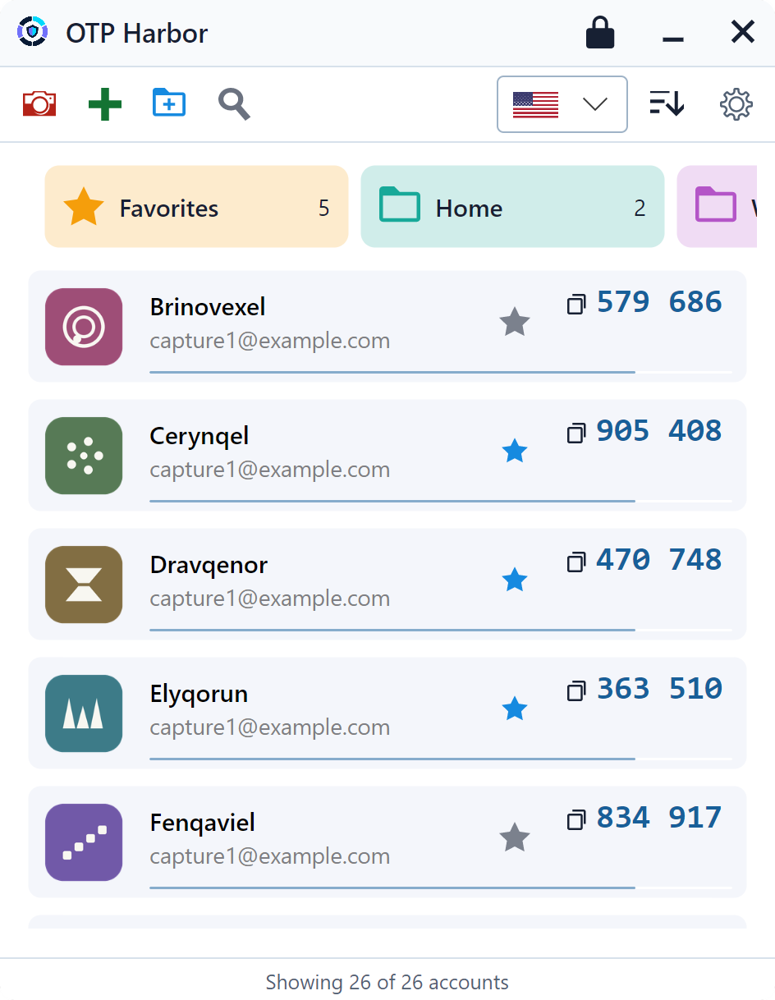
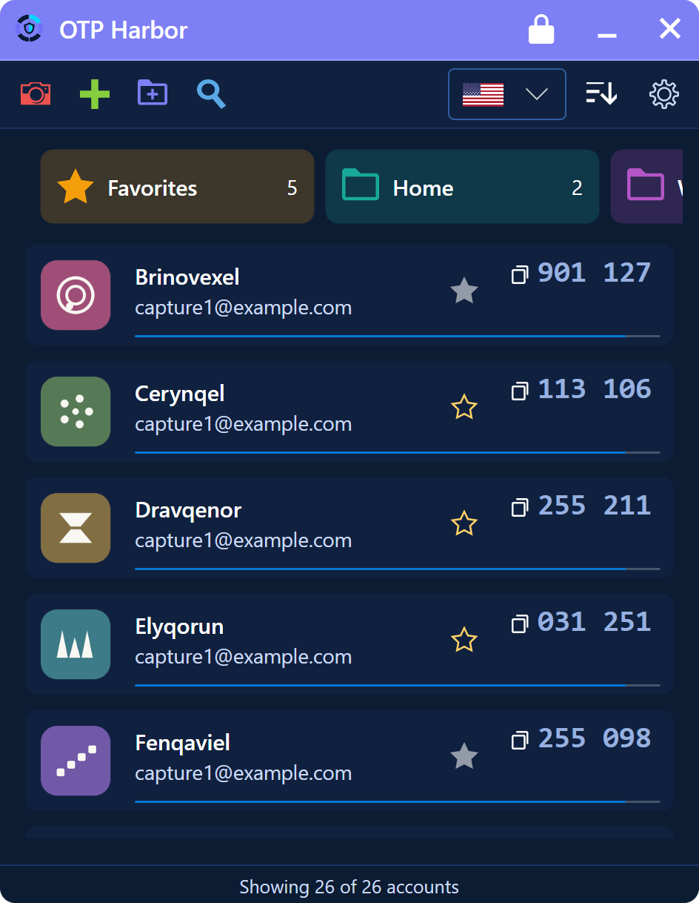
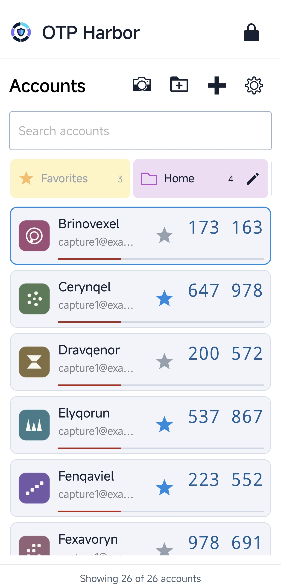
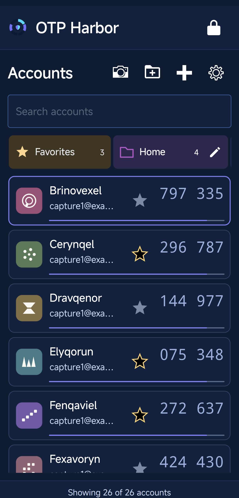

# OTP Harbor

**The local-first authenticator for desktop and Android.**

[](https://github.com/Legends/otp-harbor)
[](https://apps.microsoft.com/detail/9P31KH5L924P)
[](LICENSE.txt)

**OTP Harbor** is a GPLv3-licensed, open-source, local-first TOTP and 2FA authenticator for Windows, Linux, and Android. It protects OTP seeds in an encrypted local vault and supports QR workflows, platform quick unlock, and encrypted backup and restore without requiring a cloud account.

<!-- BEGIN GENERATED RELEASES -->
## Latest releases

<!-- Generated by scripts/release/Update-ReadmeReleases.py; edit the generator, not this block. -->

| Platform | Latest stable release | Published (UTC) | Downloads and release information |
| --- | --- | --- | --- |
| Desktop / Linux | [v3.0.2](https://github.com/Legends/otp-harbor/releases/tag/v3.0.2) | 2026-11-06 | [Linux tarball](https://github.com/Legends/otp-harbor/releases/download/v3.0.2/OTP-Harbor-linux-x64-3.0.2.tar.gz) · [DEB](https://github.com/Legends/otp-harbor/releases/download/v3.0.2/otp-harbor_3.0.2_amd64.deb) · [Integrity metadata](https://github.com/Legends/otp-harbor/releases/download/v3.0.2/release-artifacts-v2.json) · [Release notes](https://github.com/Legends/otp-harbor/releases/tag/v3.0.2) |
| Android | [android-v3.0.2](https://github.com/Legends/otp-harbor/releases/tag/android-v3.0.2) | 2026-11-06 | [APK](https://github.com/Legends/otp-harbor/releases/download/android-v3.0.2/OTP-Harbor-android-universal-3.0.2.apk) · [Checksums](https://github.com/Legends/otp-harbor/releases/download/android-v3.0.2/SHA256SUMS) · [Integrity metadata](https://github.com/Legends/otp-harbor/releases/download/android-v3.0.2/release-artifacts-v2.json) · [Release notes](https://github.com/Legends/otp-harbor/releases/tag/android-v3.0.2) |

Desktop and Android versions ship independently. This table tracks published stable GitHub releases; Windows availability and updates are managed separately by the Microsoft Store.
<!-- END GENERATED RELEASES -->

Windows is delivered through the [Microsoft Store](https://apps.microsoft.com/detail/9P31KH5L924P), where OTP Harbor `2.0.1` is publicly available and Microsoft signs accepted MSIX packages. GitHub release versions and Store approval advance independently.

<h3>Desktop app: Light and Dark themes</h3>

<p align="center">
  
  &emsp;&emsp;
  
</p>

<h3>Android app: Light and Dark themes</h3>

<p align="center">
  
  &emsp;&emsp;
  
</p>

These are optimized captures from live apps using disposable demo vaults. Each pair shows the same account list in Light and Dark themes. [Browse the full screenshot gallery](https://legends.github.io/otp-harbor/#showcase) when the v3 marketing review is complete.

## Optional brand icons in v3

1. Visit the separate [OTP Harbor Icon Pack Builder](https://github.com/Legends/otp-harbor-icon-pack-builder) project and download the build for your computer from its [latest release](https://github.com/Legends/otp-harbor-icon-pack-builder/releases/latest). Check the download against that release's `SHA256SUMS.txt` before running it.
2. Run the builder and follow its prompt to create `otp-harbor-icons.otphicons` in Downloads. The builder downloads its pinned, tested icon sources when run; OTP Harbor does not fetch icons while you use the app.
3. In the v3 app, open **Settings → Icon packs → Import OTP Harbor icon pack** and select the generated `.otphicons` file. To import on Android, transfer the file to that device first. Matching brand icons then become available for accounts whose issuers the pack recognizes.

**Legal notice:** The builder can use artwork from the independent Aegis Icons, Simple Icons, and Dashboard Icons projects. OTP Harbor does not bundle or host their collections or generated packs, and it grants no rights to third-party icons, names, or trademarks. Project-level licenses do not necessarily cover each depicted brand mark; individual assets may have separate license, attribution, trademark, and brand-guideline requirements. Before using or sharing a pack, check its available notices and provenance, the upstream [Aegis Icons license](https://github.com/aegis-icons/aegis-icons/blob/master/LICENSE.md), [Simple Icons license](https://github.com/simple-icons/simple-icons/blob/develop/LICENSE.md) and [disclaimer](https://github.com/simple-icons/simple-icons/blob/develop/DISCLAIMER.md), [Dashboard Icons license](https://github.com/homarr-labs/dashboard-icons/blob/main/LICENSE), and each relevant rights holder's terms. You are responsible for compliant use; compatibility does not imply affiliation, sponsorship, or endorsement. Seek qualified legal advice if redistribution rights are unclear.

## Features

- TOTP with SHA-1, SHA-256, or SHA-512 and 6- or 8-digit codes on Desktop and Android (SHA-1 / 6 digits by default)
- AES-256-GCM encrypted local vault with Argon2id password derivation
- Windows Hello and Android device quick unlock with master-password recovery
- Account creation, editing, search, deletion, QR import/export, Google Authenticator bulk migration, and local `otpauth://` URI-list import
- Automatic clipboard clearing and idle/session locking
- Encrypted `.otphbp` backups, legacy `.totp` import, automatic recovery copies, and restore conflict handling
- English, German, French, and Spanish UI
- Desktop application for Windows and Linux
- Focused Android app with strong-biometric, device-screen-lock (PIN, pattern, or password), or master-password unlock,
  camera-based QR import, swipe actions, and the
  same encrypted backup format as desktop

## System requirements

### Android

- Android 9 (API level 28) or newer
- Internal device storage for the encrypted local vault; OTP Harbor does not require a cloud account
- A master password, which is required during first-run setup and remains the recovery method
- Optional quick unlock requires either Android-supported strong biometrics or a configured secure device screen lock; the master password works without either feature
- Camera permission is required only for live QR scanning; accounts can still be entered or imported without granting camera access
- Manual and automatic backups use Android's system file or folder picker. Automatic backups require a writable folder selected by the user; Android may reject protected locations such as the root of internal storage
- Installing the GitHub APK may require allowing APK installation for the browser or file manager used to open it. Future in-place updates must come from an APK signed by the same distribution channel

### Desktop

- Windows 10 or 11 on x64 for the Microsoft Store edition
- Ubuntu 24.04 on x64 for the published DEB and portable Linux packages

The public [Android product page](https://legends.github.io/otp-harbor/android/) presents the mobile edition, while the dedicated [Android user guide](https://legends.github.io/otp-harbor/android/guide/) explains first-run setup, tap-to-copy, left/right swipe actions, camera and Google Authenticator QR workflows, per-account QR display, encrypted backup conflict handling, unlock-method recovery, and the optional app-lock setting.

Accounts use the common TOTP profile by default: SHA-1, six digits, and a 30-second code period. The period can be adjusted between 5 and 3600 seconds under **Advanced options** when adding or editing an account, if the provider requires a value other than 30 seconds. For example, a 10-minute period is entered as 600 seconds.

On desktop, right-click any existing account to open its contextual actions: **Edit account**, **Show QR code**, or **Delete account**. Deletion still requires confirmation.

### Import from Google Authenticator

OTP Harbor recognizes both normal `otpauth://` account QR codes and Google Authenticator transfer QR codes. For a desktop migration, start **Transfer accounts** / **Export accounts** in Google Authenticator, capture each generated QR code as a crisp screenshot, and choose each saved image in **Settings > Import / Export > Import from Google Authenticator**. OTP Harbor shows the number of detected accounts and asks for confirmation before changing the vault; multi-part exports prompt you to choose the next QR image. Android can scan the transfer QR codes directly with its camera workflow.

Treat migration QR codes as secrets: anyone who captures one can recreate the exported accounts. After importing, verify several generated codes and create a fresh encrypted OTP Harbor backup.

Desktop and Android can also import a local `.txt` file containing one standard `otpauth://` TOTP URI per line, an unencrypted [Aegis JSON vault export](https://github.com/beemdevelopment/Aegis/blob/master/docs/vault.md), or an unencrypted [2FAS `.2fas` backup](https://2fas.com/support/2fas-auth-mobile-app/i-want-to-move-copy-transfer-tokens-codes-between-ios-and-android/). JSON, CSV, and OTP Harbor text account files remain supported. Password-protected Aegis and 2FAS backups are deliberately rejected rather than attempting a partial or incompatible decryption flow. Imports are parsed locally, previewed before mutation, and protected by the same recovery-backup and conflict-resolution workflow. Treat every unencrypted account file as secret material and remove it from shared storage after verifying the migration.

## Upgrading from v2 to v3

During upgrade, v3 accepts a supported v2 `TVLT` vault as migration input. It first creates a private `pre-upgrade-rollback` copy beside the vault containing the original encrypted `master.totp`, its authorization envelope when present, and available rotating backups. After the original master password unlocks the vault, the first account load converts the active vault to v3's `TVL2` format before showing the accounts. V3 then uses the converted vault; the v2 copy remains available for rollback. An external encrypted export is still recommended because the local copy shares the same device.

To return to v2 after conversion, close OTP Harbor, preserve the current data directory, and restore the matching vault and authorization envelope from `pre-upgrade-rollback` to the paths expected by v2. On Windows, v2 uses `%APPDATA%\TOTP-Manager` and v3 uses `%APPDATA%\OTP-Harbor`. Unlock with the original master password. V2 cannot open a v3 `TVL2` vault directly. See the [recovery guide](docs/RECOVERY.md) for the complete procedure and Android limitations.

## Desktop experience

The v3 preview above shows Light and Dark themes with 26 fictional demo accounts. Account creation, search, QR import, quick unlock, and encrypted backup remain available; feature screenshots will join the gallery after visual review. Never publish screenshots containing a real account secret.

### Keyboard shortcuts

| Action | Shortcut |
| --- | --- |
| Search accounts | <kbd>Ctrl</kbd> + <kbd>F</kbd> |
| Copy the selected account code | <kbd>Ctrl</kbd> + <kbd>C</kbd> |
| Add an account | <kbd>Ctrl</kbd> + <kbd>A</kbd> |
| Edit the selected account | <kbd>Ctrl</kbd> + <kbd>E</kbd> |
| Delete the selected account after confirmation | <kbd>Ctrl</kbd> + <kbd>D</kbd> or <kbd>Delete</kbd> |
| Lock the vault | <kbd>Ctrl</kbd> + <kbd>L</kbd> |
| Close the active search, editor, settings view, or QR preview | <kbd>Esc</kbd> |

## Distribution

**[Microsoft Store](https://apps.microsoft.com/detail/9P31KH5L924P) is the primary Windows distribution channel** (Store ID `9P31KH5L924P`). Microsoft signs the published MSIX and manages Store updates.

Install from a terminal using Windows Package Manager:

```powershell
winget install --id 9P31KH5L924P --source msstore
```

[GitHub Releases](https://github.com/Legends/otp-harbor/releases/latest) provides stable Linux downloads and source archives. [Android releases](https://github.com/Legends/otp-harbor/releases?q=android-v) independently provide production-signed APKs. Portable Linux packages use an Ed25519-signed appcast; Microsoft Store packages rely only on Store-managed updates.

| Platform | Package type |
| --- | --- |
| Windows 10/11 x64 | Public Microsoft Store MSIX only; Microsoft signs accepted packages and manages updates |
| Ubuntu 24.04 x64 | DEB or self-contained tarball |
| Android 9 or newer | Production-signed universal APK from an independent `android-vX.Y.Z` GitHub release; manual installation with in-place upgrade support |

After launch, create a master password and add an account manually, scan an `otpauth://` QR code, or import each saved QR image from a Google Authenticator bulk export in sequence. Treat QR images, OTPs, seeds, exports, and backups as secrets.

Only install Windows builds from the Microsoft Store. Repository-generated unsigned MSIX files are not end-user packages and must not be sideloaded. For Android, use a production-signed APK from an `android-vX.Y.Z` GitHub release.

The latest-release table above is generated after every Desktop or Android release, with daily reconciliation and a manual refresh workflow. See [README release automation](docs/release/README_RELEASES.md) for maintenance and permissions.

## Security and recovery

The master password is the portable recovery path. Quick unlock is a convenience and never replaces it. Keep an external encrypted export and test restoration periodically.

- [Security policy](SECURITY.md)
- [Recovery guide](docs/RECOVERY.md)
- [Privacy policy](PRIVACY.md)

Report vulnerabilities privately as described in [SECURITY.md](SECURITY.md). Never attach real secrets, vaults, backups, or unreviewed logs.

## License

Current OTP Harbor revisions are licensed under the [GNU General Public License version 3 only](LICENSE.txt) (`GPL-3.0-only`). GPLv3 permits commercial use and redistribution subject to its copyleft and corresponding-source requirements. See [LICENSING.md](LICENSING.md) for scope, contribution terms, trademark boundaries, and the immutable license history of earlier revisions. Third-party components remain under their respective licenses listed in [THIRD_PARTY_NOTICES.md](THIRD_PARTY_NOTICES.md).
